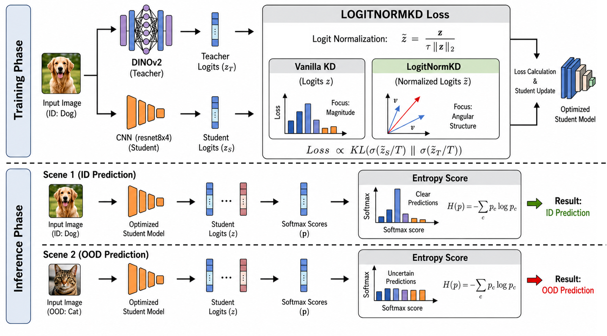
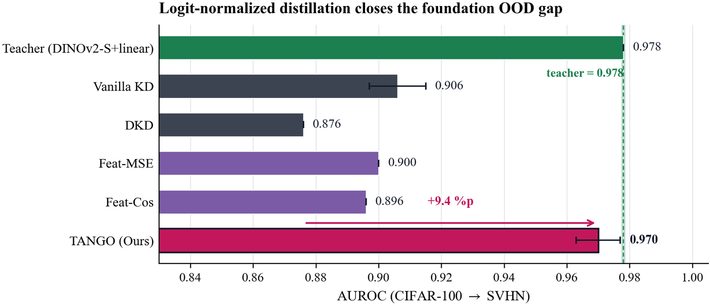
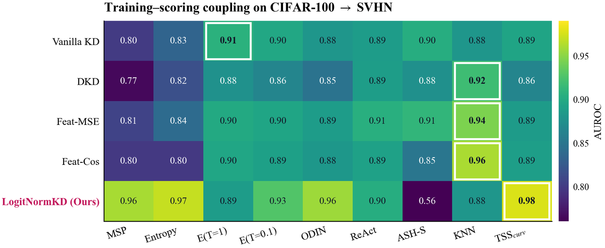

<p align="center">
  
  
</p>

<h1 align="center">TANGO : Logit-Normalized Distillation Preserves OOD Ability in Foundation Models and Reshapes Which Scores Work</h1>


<p align="center">
  <strong>Yeongje Park · Eui Chul Lee</strong><br />
  Sangmyung University
</p>

<p align="center">
  <a href="#overview">Overview</a> ·
  <a href="#results">Results</a> ·
  <a href="#quickstart">Quickstart</a> ·
  <a href="#method">Method</a> ·
  <a href="#reproducibility-notes">Reproducibility</a>
</p>

---

## Overview

**Can we compress the OOD judgment of a foundation model into a small CNN—without losing the ability to recognize unfamiliar data?**

Foundation models such as DINOv2 and CLIP exhibit strong out-of-distribution (OOD) detection performance. Yet conventional knowledge distillation (KD) can erode that ability even when the student remains an effective in-distribution (ID) classifier.

**TANGO** makes a minimal change to training: **L2-normalize teacher and student logits inside the loss**. At test time, the student uses its *raw* logits and the ordinary predictive-entropy score—**no architectural changes and no additional inference cost**.

<p align="center">
  
</p>

### The result, at a glance

| Benchmark | Metric | Vanilla KD | **TANGO** | Change |
|:--|:--|--:|--:|--:|
| CIFAR-100 | ID accuracy | 0.733 | **0.771** | **+3.8 pp** |
| CIFAR-100 | Far-OOD AUROC · Entropy | 0.727 | **0.834** | **+10.7 pp** |
| ImageNet-1K | ID accuracy | **0.676** | 0.675 | −0.1 pp |
| ImageNet-1K | Far-OOD AUROC · Entropy | 0.794 | **0.880** | **+8.6 pp** |

<sub>CIFAR-100: three-seed means; ImageNet-1K: single runs. Far-OOD datasets and evaluation details are given below.</sub>

> [!IMPORTANT]
> **Far-OOD improvement comes with a near-OOD trade-off.** On CIFAR-100 → CIFAR-10, TANGO loses approximately **6–7 pp** of near-OOD performance. We report this explicitly rather than treating OOD detection as a single, uniform objective.

## Results

### CIFAR-100 → Far-OOD

**Student:** ResNet8x4 (1.2M parameters) · **Teacher:** frozen DINOv2-S + linear probe · **Runs:** three seeds.

`far₄` is the mean AUROC across **MNIST / SVHN / DTD / Places365**. Every entry below uses **predictive entropy** for OOD scoring.

| Method | ID Acc. ↑ | SVHN AUROC ↑ | far₄ AUROC ↑ |
|:--|--:|--:|--:|
| Teacher (DINOv2-S + linear probe) | **0.830** | **0.978** | 0.806 |
| Vanilla KD | 0.733 | 0.906 | 0.727 |
| DKD | 0.728 | 0.883 | 0.725 |
| Feat-MSE | 0.748 | 0.902 | 0.752 |
| Cosine-Feat | 0.730 | 0.867 | 0.748 |
| LogitNorm-CE (no teacher) | 0.736 | 0.907 | 0.767 |
| ELogitNorm-CE (no teacher) | 0.734 | 0.942 | 0.792 |
| **TANGO** | **0.771** | **0.970** | **0.834** |

<p align="center">
  
</p>

### ImageNet-1K → Far-OOD

**Student:** ResNet18 · **Protocol:** OpenOOD large-scale · **Runs:** single run per method.

Far-OOD comprises **iNaturalist / Textures / OpenImage-O**.

| Method | ID Acc. ↑ | Far-OOD Entropy AUROC ↑ | Far-OOD Energy AUROC ↑ |
|:--|--:|--:|--:|
| Teacher (frozen) | **0.799** | **0.905** | **0.940** |
| Vanilla KD | **0.676** | 0.794 | 0.873 |
| **TANGO** | 0.675 | **0.880** | 0.220 |

Vanilla KD achieves a strong Energy score (**0.873**), but TANGO with the **preselected Entropy readout** reaches **0.880**. TANGO's Energy AUROC drops to **0.220**, illustrating how the same training change can improve one score while reversing another.

### Additional settings

The pattern extends to **CIFAR-10 ID** (far₄ **0.947** for TANGO vs. **0.918** for the best baseline), **ImageNet-200**, **ImageNet-100**, a **WRN-40-2** student, and **CLIP / DINOv2-B** teachers.

## Quickstart

Install the dependencies:

```bash
pip install -r requirements.txt
```

Evaluate the released **TANGO** checkpoint on SVHN (auto-downloaded on first use):

```bash
python eval_ood.py \
  --checkpoint checkpoints/cifar100_resnet8x4/logitnormkd_seed0.pt \
  --ood svhn
```

Run the same evaluation for **vanilla KD**:

```bash
python eval_ood.py \
  --checkpoint checkpoints/cifar100_resnet8x4/vanillakd_seed0.pt \
  --ood svhn
```

**Representative output — CIFAR-100 → SVHN, seed 0**

| Student | Mean ID ‖z‖₂ | Entropy AUROC ↑ | Energy@T=1 AUROC ↑ |
|:--|--:|--:|--:|
| Vanilla KD | ~31 | 0.839 | **0.907** |
| **TANGO** | **~1.3** | **0.978** | 0.113 |

For the released TANGO checkpoint, the evaluator also reports Entropy **AUROC / FPR@95 = 0.9777 / 0.105** and Energy@T=1 **AUROC / FPR@95 = 0.1131 / 0.999**.

> **How to read the inversion:** `eval_ood.py` reports **raw AUROC**, without reversing score orientation to exceed 0.5. An AUROC below 0.5 means that the ID/OOD ranking is inverted under that score's chosen orientation.

## Method

### One normalization, applied during training

For each teacher or student logit vector \(z\), TANGO uses

$$
\widetilde{z} = \frac{z}{\tau \lVert z \rVert_2}, \qquad \tau = 0.04.
$$

The normalized logits feed both the **cross-entropy** and **distillation** terms:

```python
import torch.nn.functional as F


def normalize_logits(z, tau=0.04):
    return z / (tau * z.norm(p=2, dim=1, keepdim=True).clamp_min(1e-12))


z_s = normalize_logits(student_logits)
z_t = normalize_logits(teacher_logits.detach())

loss_ce = F.cross_entropy(z_s, labels)
loss_kd = T**2 * F.kl_div(
    F.log_softmax(z_s / T, dim=1),
    F.softmax(z_t / T, dim=1),
    reduction="batchmean",
)
loss = loss_ce + loss_kd
```

**At inference, normalization is removed:** compute OOD scores from the student's **raw logits**, exactly as for an ordinary classifier. No new network modules or additional inference passes are needed.

### Why the choice of OOD score changes

In the released CIFAR-100 example, mean ID logit magnitude shrinks from approximately **31 to 1.3**—about a **24× reduction**. This compression coincides with a major change in which OOD scores work well.

| Score family | Score | Δ Far-OOD AUROC (TANGO − Vanilla KD) |
|:--|:--|--:|
| Predictive distribution | MSP | **+0.124** |
| Predictive distribution | Entropy | **+0.107** |
| Logit-based | MaxLogit | +0.045 |
| Feature statistics | GRAM | +0.002 |
| Feature statistics | RMDS | +0.018 |
| Feature / distance-based | KNN | −0.044 |
| Feature ensemble | MDSEns | −0.160 |
| Logit-based | Energy | −0.171 |
| Feature / distance-based | MDS | −0.266 |
| Feature / subspace-based | ViM | −0.452 |

<p align="center">
  
</p>

**Interpretation.** By suppressing incentives to encode confidence in the **logit norm**, TANGO changes the information available to magnitude-sensitive scores. **Predictive entropy** is particularly effective after this shift; **Energy** can deteriorate dramatically. Thus, *OOD preservation and OOD score selection should be analyzed together*.

### A checkable gradient property

For the normalized logit mapping, the loss gradient is orthogonal to the logit vector, apart from numerical effects. A minimal sanity check:

```python
import torch
from tango import logit_norm

z = torch.randn(4, 100, requires_grad=True)
logit_norm(z, 0.04).sum().backward()
print((z.grad * z).sum(dim=1).abs().max())  # ~1e-7
```

This establishes the normalization's **radial gradient property**; the measured AUROC changes above are the empirical evidence for the scoring behavior.

## Train from scratch

```bash
# TANGO
python train.py --method logitnormkd --seed 0

# Vanilla-KD baseline
python train.py --method vanillakd --seed 0

# Minimal 2-epoch smoke test
python train.py --method logitnormkd --epochs 2 --limit-batches 5
```

The defaults reproduce `configs/cifar100_*_seed*.yaml`:

| Setting | Value |
|:--|:--|
| Optimizer | SGD · momentum **0.9** · weight decay **5e-4** |
| Epochs / batch size | **100** / **64** |
| Initial learning rate | **0.05** |
| LR schedule | MultiStep · milestones **[60, 80, 90]** · factor **0.1** |
| TANGO | `T=4`, `tau=0.04`, `ce_w=1`, `kd_w=1` |
| Vanilla KD | `T=4`, `alpha=0.1`, `beta=9` |
| Teacher | Frozen `facebook/dinov2-small` + released linear probe |

The teacher head is provided in `checkpoints/teacher_heads/`. The backbone requires `transformers` and an approximately **90 MB** one-time download. Estimated training time is **~90 minutes per seed on an RTX 4080**.

## Repository structure

```text
.
├── tango/
│   ├── logitnorm_kd.py   # TANGO and vanilla-KD objectives
│   ├── scores.py         # Entropy, Energy, MSP, MaxLogit, AUROC, FPR@95
│   ├── resnet.py         # ResNet8x4 student
│   ├── teacher.py        # Frozen DINOv2 and released linear probe
│   └── data.py           # CIFAR-100 ID / OOD datasets and preprocessing
├── train.py              # Training entry point
├── eval_ood.py           # Evaluation entry point
├── configs/              # Exact released-checkpoint configurations
├── checkpoints/          # 3 seeds each: TANGO / vanilla KD
│                         # + 2 ImageNet-1K ResNet18 students
│                         # + teacher linear probes
└── assets/               # Method and result figures
```

## Reproducibility notes

1. **ID preprocessing is essential.** OOD images are resized to **32×32** and normalized with the **ID dataset's statistics**. Changing the constants in `tango/data.py` will change the results.
2. **Score orientation is not silently corrected.** `eval_ood.py` emits raw AUROC. The paper's **Table 1 and Figure 3** empirically orient each *(method, score)* pair; supplementary **Table 20** reports raw scores. This distinction is especially important for TANGO + Energy.
3. **Single checkpoints are not three-seed means.** The CIFAR-100 tables report three-seed averages. Energy on CIFAR-100 → SVHN inverts for **TANGO seed 0**, but not for seeds **1–2**.
4. **NINCO directory selection matters.** For ImageNet near-OOD, use `NINCO/NINCO_OOD_classes` (**5,878 images**). Recursively globbing the entire release also includes `popular_datasets_subsamples`, changing the result.
5. **Some OOD datasets need local files.** `svhn`, `cifar10`, `mnist`, and `dtd` auto-download; `tin`, `places365`, and `lsun_c` require a local copy. The expected paths are documented in `tango/data.py`.
6. **MDSEns uses equal ensemble weights.** OpenOOD's `alpha_selector` can instead fit weights using ID-versus-OOD validation data. We avoid that additional OOD-supervised calibration in the detector comparison.

## Citation

If you use TANGO in your research, please cite our **BMVC 2026** paper. The entry below is provisional until the final proceedings metadata becomes available.

```bibtex
@inproceedings{park2026tango,
  title     = {TANGO: Logit-Normalized Distillation Preserves OOD Ability in Foundation Models and Reshapes Which Scores Work},
  author    = {Park, Yeongje and Lee, Eui Chul},
  booktitle = {British Machine Vision Conference (BMVC)},
  year      = {2026},
  note      = {To appear}
}
```

---

<p align="center"><strong>Distillation changes more than the student—it can change which OOD scores reveal what the student knows.</strong></p>
